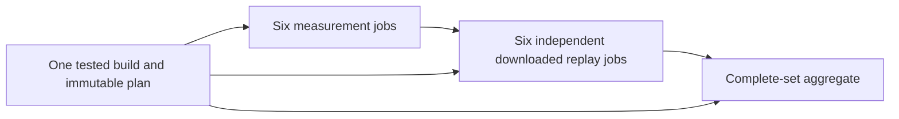

# Independent hosted M01–M04 experiment

This branch-only workflow runs the **28 complete measurement histories** on
GitHub-hosted Linux runners. It is separate from protected full CI, the committed
single-machine [local cohort](PHASE_6_MACHINE_COHORT.md), and paid cloud admission.
A successful hosted result does not close those other gates or reuse their source
identity. No production Java, frozen workload, local machine JSON, regular CI
trigger, Required check or release workflow is changed by this experiment.

## Trigger and scope

- Branch: `experiment/v52-hosted-measurements`.
- Workflow: `.github/workflows/v52-hosted-measurements.yml`.
- Trigger: a push to that exact branch, **without opening a PR**. Regular CI listens
  to master pushes and PR events. Opening a PR will therefore start regular CI.
- Do not add `[skip ci]`: it also skips this experiment's push event.
- There is no master merge, workflow dispatch bootstrap, repository setting change,
  environment approval, OIDC permission or GCP provisioning in this path.
- The build runs the reactor tests once. The workflow does **not** reproduce the
  operator acceptance driver's twelve other regression gates or its remote-adapter
  qualification. It addresses the expensive 28-history measurement portion only.

GitHub documents [push branch filters](https://docs.github.com/en/actions/reference/workflows-and-actions/events-that-trigger-workflows#push)
and [skip directives](https://docs.github.com/en/actions/how-tos/manage-workflow-runs/skip-workflow-runs).

## Execution graph



| Shard | Histories | Scheduling boundary |
| --- | ---: | --- |
| `m01-r1` | 5 | All five modes of repetition 1, serial on one runner |
| `m01-r2` | 5 | All five modes of repetition 2, serial on one runner |
| `m01-r3` | 5 | All five modes of repetition 3, serial on one runner |
| `minimum-waits` | 9 | All M02 relation/wait combinations, serial |
| `capacity` | 2 | Both M03 pending-capacity cases, serial |
| `recovery` | 2 | Both complete M04 recovery histories, serial |

Every history keeps its existing controller, three JVMs, startup, offered calls,
faults, shutdown, physical authority and query oracle. No continuous history is
cut into time slices. M01 keeps 60 seconds warmup plus 120 seconds measurement per
history: 2700 total offered seconds, 27373 original reads and 2745 updates across
M01–M04. No offered outcome is filtered. The 439 prescribed negatives are checked
at both locations (878 rejections in total).

The six jobs can run concurrently; the actual concurrency and queue time depend
on available GitHub runner capacity. Each job serializes its own histories and
validation. M01 controls and candidate modes share one machine **within a
repetition**; different repetitions/shards have different recorded machines.
Do not combine their timings as if they were one invariant local host. This is
also three JVMs on each host, not a three-host distributed cloud measurement.

## Admission and evidence contracts

1. A clean checkout and exact event SHA are mandatory. The existing build bundle
   verifies source fingerprint, Java identity, JARs and executed prerequisite tests.
   The build compiles both consumer families before measurements, freezes their
   hashes and every workload/negative rule, and distributes hash-pinned published
   control JARs. No Maven Central download is needed during a measured history.
2. Each shard captures CPU, memory, kernel, affinity, boot ID, filesystem, cgroup,
   Python, Java/javac identities and runner-image metadata **before its first
   history**. Source and machine identity are checked around every history. The
   existing 16 GiB minimum free-space admission remains in effect. Standard
   runners only [advertise 14 GB SSD capacity](https://docs.github.com/en/actions/reference/runners/github-hosted-runners),
   so the workflow does not assume that a fresh image already meets this gate.
   Before toolchain setup and environment freeze, it reclaims fixed unused
   .NET/Android/Haskell SDK directories on the **disposable GitHub-hosted VM only**,
   aiming for 32 GiB free. It fails immediately if 16 GiB is still unavailable.
   Explicit hosted-runner/event/ref/repository guards prevent local execution;
   source, Java, Python, Maven, Docker and runner-agent directories are untouched.
3. The producer replays every original history, including all negatives, then
   creates a bounded, hash-indexed archive. Only successfully replayed and packed
   raw copies are removed to bound runner disk use. A failed history remains raw;
   completed archives and previous receipts remain available.
4. Separate jobs download those immutable archives, check the frozen source,
   build, run, attempt, member set, timestamps, hashes and inventories, then
   independently decode physical evidence and execute the query/negative oracles.
   They compare full results with the original replay. Producer PASS declarations
   alone cannot establish success. Replays use the existing original-path mapping
   for copied physical authority.
5. Shards only return `PARTIAL`. The aggregate consumes the **independent verifier**
   artifacts, requires all six groups and 28 unique domains/histories, exact call
   counts, exact negatives, identical build/compiled identities, and one workflow
   run/attempt. Its trust boundary is these jobs in this exact-source workflow;
   arbitrary JSON supplied outside that workflow is not a certified result.
6. The aggregate reports `hostedAcceptance=true`, `localMachineAcceptance=false`,
   `cloudAcceptance=false`, `protectedFullCI=false`, and `paidCloud=false`. The
   existing single-machine validator and its sole-freeze-commit rule are unchanged.

Raw, diagnostic, verified and aggregate artifact names contain run ID, attempt,
source SHA and shard. Retention is 14 days. Download important evidence before it
expires; the local D-drive archive automation does not run on hosted machines.

## Progress, failure and rerun behavior

Measurement preparation, execution, packing and both replay stages emit JSON
progress at phase boundaries and every 60 seconds: active history, completed
count, phase duration, total duration, free disk and PID. A heartbeat means the
controller is alive; it is not proof that a workload made semantic progress.
Each command also writes `progress.json`, incremental `receipt.json`, `result.json`
and a readable GitHub step summary.

No new per-stage timeout or business retry is added. Existing protocol and
bounded-close deadlines are preserved. GitHub-hosted jobs still have the
[platform's six-hour maximum](https://docs.github.com/en/actions/reference/limits);
the workflow declares 360 minutes rather than imposing a smaller new ceiling.
The existing Maven wrapper retries only classified infrastructure failures and
retains every attempt; a failing test is not silently retried by this driver.

`fail-fast: false` preserves results from other shards. A failed or incomplete
history stops its shard and cannot qualify. Downloaded replay jobs may still
inspect the successful shards for diagnosis; the final result remains failed.
A new workflow run or **Re-run all jobs** creates a new complete cohort. **Re-run
failed jobs** cannot produce acceptance by mixing an old build or successful
shards with a new attempt: artifact names and plan identity reject that mix.
There is no automatic resume or splice with the currently running local cohort.

## Operator commands

The isolated worktree is `/tmp/gse-v52-hosted-measurements`; the original worktree
and `/tmp/gse-v52-precloud-contract` must remain unchanged while local acceptance
runs. Do not switch branches in the original worktree during that run.

After local results are reviewed, carry any required source fix into the experiment
branch, rerun the focused orchestration tests, then publish **from this worktree**:

```bash
cd /tmp/gse-v52-hosted-measurements
python3 -m unittest scripts.v52.test_hosted_measurements

git add -- \
  .github/actions/v52-hosted-setup/action.yml \
  .github/workflows/v52-hosted-measurements.yml \
  scripts/v52/hosted_measurement_contract.py \
  scripts/v52/hosted_measurements.py \
  scripts/v52/test_hosted_measurements.py \
  docs/v5x/v5.2/HOSTED_MEASUREMENT_EXPERIMENT.md

git commit -m "test: add isolated hosted V5.2 measurement cohort"
git push -u origin experiment/v52-hosted-measurements
```

The push itself starts the experiment. **Do not create a PR for this branch.**
No workflow has been dispatched merely by preparing these files. If an additional
local fix was committed after this branch's base, port that reviewed commit before
pushing; the hosted build must include the fix and creates fresh source-bound
measurements. The old local frozen-machine JSON is not used for hosted admission.

Inspect and download results without changing workflow state:

```bash
gh run list --workflow v52-hosted-measurements.yml \
  --branch experiment/v52-hosted-measurements --limit 5
gh run view RUN_ID
gh run download RUN_ID --dir /path/to/retained/v52-hosted-RUN_ID
```

To retire the experiment, stop pushing this branch. No master rollback or Required
change is needed. If the workflow is later proposed for regular CI, that is a
separate reviewed task; this experiment does not authorize that promotion.
